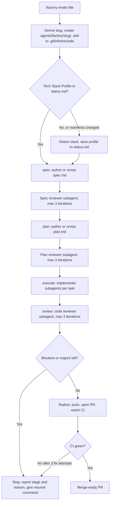
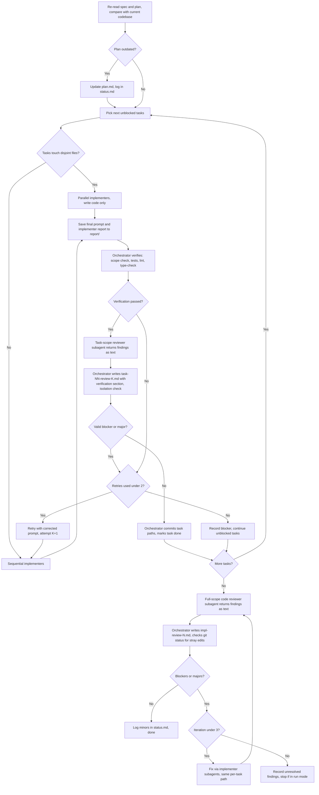
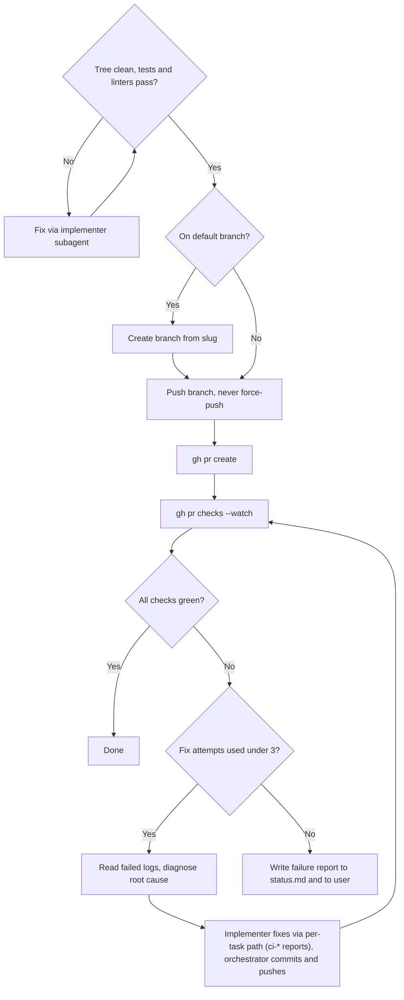

# Factory

Factory is a global Claude Code skill that runs a spec-driven delivery pipeline: it takes an issue or feature from idea to a merge-ready GitHub pull request. It detects the tech stack of the current project at runtime and adapts every stage to it.

## Modes

| Command | What it does |
|---|---|
| `/factory spec <title>` | Create or review `spec.md`, then run up to 3 independent spec reviews |
| `/factory plan [<slug>]` | Create or review `plan.md` with requirement traceability, then run up to 3 plan reviews |
| `/factory execute [<slug>]` | Run implementer subagents task by task; each task is verified by the orchestrator and reviewed by an independent reviewer before it is committed |
| `/factory review [<slug>]` | Independent code review of the diff; fix blockers and majors; up to 3 iterations |
| `/factory finalize [<slug>]` | Push, open a PR with `gh`, watch CI, fix failures (max 3 attempts) |
| `/factory run <title>` | Run all five modes with no approval gates |

If the mode is omitted but a title is given, Factory asks which mode to run.

## File Layout

```
~/.claude/skills/factory/
├── SKILL.md
├── README.md
├── prompts/
│   ├── spec-reviewer.md
│   ├── plan-reviewer.md
│   ├── implementer.md
│   └── code-reviewer.md
└── templates/
    ├── spec.md
    ├── plan.md
    ├── status.md
    └── pr-body.md
```

Per-task artifacts live in the project, in `.agents/factory/<slug>/`:

```
spec.md
plan.md
status.md
reviews/
├── spec-review-N.md
├── plan-review-N.md
└── impl-review-N.md
report/
├── task-01-prompt-1.md        final prompt sent to the implementer
├── task-01-summary-1.md       implementer report
├── task-01-review-1.md        task reviewer report + orchestrator verification
├── task-01-prompt-2.md        (retry, attempt 2)
├── task-01-fix-1-{prompt,summary,review}-1.md    fix round 1 for task 01
└── ci-01-{prompt,summary,review}-1.md            fix for a GitHub Actions failure after the PR
```

`.agents/factory/` is added to `.git/info/exclude`, so artifacts never enter commits or pull requests.

## Design Decisions

- **Orchestrator.** The main agent authors the spec and plan, spawns subagents, verifies results, commits, and opens the PR. It never writes code during `execute` and never reviews its own work.
- **Subagents.** Every subagent is a `general-purpose` agent. Specialization comes from the persona brief: a fixed base role plus a stack suffix, for example `Senior Software Engineer, Go and Gin`.
- **Reviewers are read-only.** They return their report as text; the orchestrator writes it to `reviews/`. The orchestrator detects stray edits (checksums for spec and plan, `git status` for code) and reruns the review if any are found.
- **Code reviewer context.** It receives the spec, the plan, and the diff, and may read the codebase read-only. It never sees implementer output or reasoning.
- **Implementers do not commit.** The orchestrator verifies each task and commits serially, so parallel implementers (disjoint files only) never contend for the git index.
- **Per-task review.** After the orchestrator's own verification, an independent task-scope code reviewer reviews that task's diff. A task is committed only when verification passes and no valid blocker or major remains. Failures feed a retry (max 2 retries, 3 attempts total).
- **Logs.** Each attempt saves the final prompt sent to the implementer, the implementer's report, and the review with the orchestrator's verification under `report/`. Reviewer prompts are not logged.
- **Naming.** Every file related to a task starts with `task-NN-`, fixes included (`task-01-fix-1-*`), so one glob (`task-01-*`) returns everything about that task. Only fixes for GitHub Actions failures after the PR exists use `ci-NN-*`.
- **CI fixes.** The orchestrator diagnoses the failure; an implementer subagent writes the fix.
- **GitHub only.** `git` and `gh` are the only tools named in `SKILL.md`. All other commands come from the Tech Stack Profile in `status.md`.
- **`run` stops before `finalize`** if any task is blocked or any blocker or major finding remains after the third implementation review.

## Flow Diagrams

### 1. Pipeline overview



Running a single mode enters the pipeline at that stage. If its prerequisite artifact is missing, the earlier stage runs first.

### 2. Execute and review loop



### 3. Finalize and CI loop



## Persona Example

For a Go project, `prompts/implementer.md` is filled by the orchestrator at brief-generation time:

```
# Persona: Senior Software Engineer, Go and Gin

Mission: Implement exactly the assigned task, test-first, with a minimal diff, and report results truthfully.

## Tech Stack
Go 1.22, Gin, sqlc, golangci-lint

## Project Conventions
(from CLAUDE.md and existing code) wrap errors with %w, pass context.Context as the first argument, table-driven tests
```

Mission and "must not" list stay identical across projects; only the stack suffix, `{{TECH_STACK}}`, and `{{PROJECT_CONVENTIONS}}` change.
